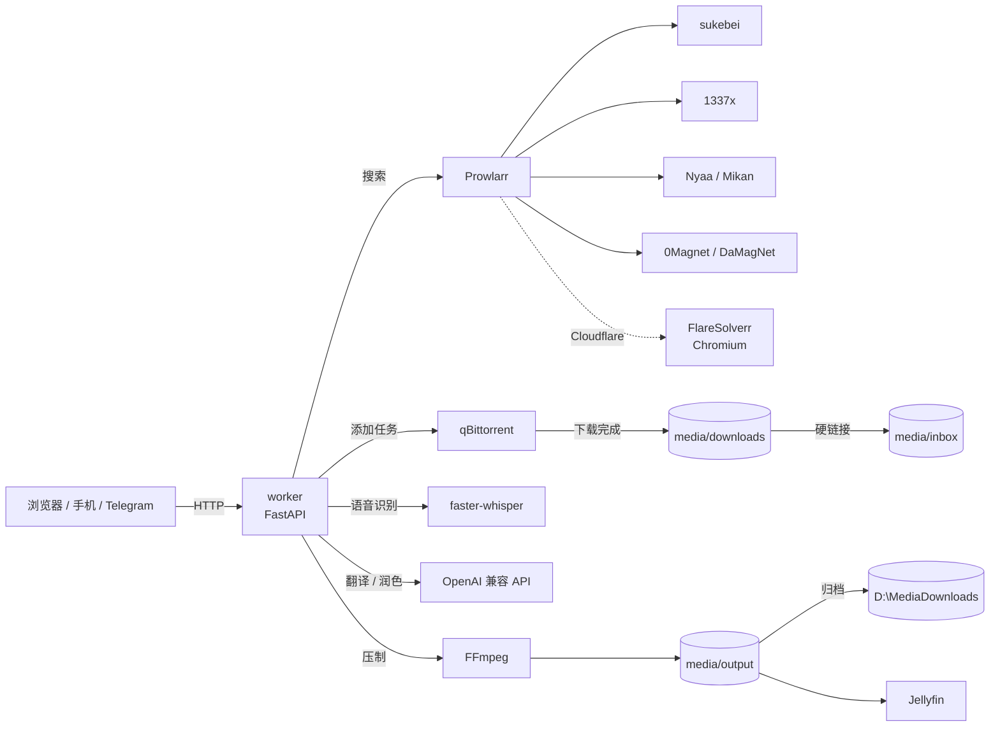

<div align="center">

# 🎬 媒体自动化 · Media Automation

**搜片 → 下载 → 自动中文字幕 → 压制 MP4 → 手机直接看**

一个跑在自己电脑上的私人影视流水线：聚合 20+ 索引器搜索，选中的资源交给 qBittorrent 下载，
worker 自动用 Whisper 识别语音、调用大模型翻译成中文，再用 FFmpeg 把字幕烧进视频。

[](https://www.python.org/)
[](https://fastapi.tiangolo.com/)
[](https://docs.docker.com/compose/)
[](#-测试)
[](#-许可)

</div>

---

## 📌 它解决什么问题

网盘要会员、离线要额度、公网种子做种又少得可怜——

这套东西把「找资源」和「看完」之间所有琐碎步骤自动化了：

```
输入片名
   ├── 20+ 索引器并发搜索（含 Cloudflare 站点）
   ├── 关键词自动扩展（中文 ↔ 日文 / 英文）
   └── 勾选 1~10 个结果
            ↓
   qBittorrent 下载（慢种自动换源 / 失败自动重试）
            ↓
   Whisper 识别语音 → 大模型翻译中文（术语表 / 双语 / 断点续翻）
   + 无对白空档抽帧识别画面上的日文字幕
            ↓
   FFmpeg 压制硬字幕 MP4 → 自动归档到指定磁盘
            ↓
   网页任务卡 / 二维码 / 短链接 / Jellyfin 在线播放 → 手机
```

---

## ✨ 功能特性

### 🔍 搜索与发现

| 功能 | 说明 |
|---|---|
| 多索引器聚合 | Prowlarr 统一调度 20+ 公共索引器，结果按做种数 + 画质智能排序 |
| Cloudflare 站点 | 内置 FlareSolverr，1337x / EZTV / 0Magnet / DaMagNet 等站点可直接搜 |
| 一键接入 | `python indexers.py add` 批量写入推荐索引器，并逐个测试连通性 |
| 关键词扩展 | 中文搜不到时自动按日文 / 英文别名再搜一轮，合并去重 |
| 内容级去重 | 同一资源被多站重发时自动合并，做种最多的那条留下，其余折叠 |
| 智能标注 | 自动解析 `4K / 1080p / HEVC / 中字 / 无码 / HDR`，并按做种数显示健康色带 |
| 最新 / 热门 | 「看看最新」按发布时间、「看看热门」按做种数、「AV 热门」只看成人站 |
| 手动链接 | 搜索框直接粘 `magnet:` 或 `.torrent` 链接 |

### ⬇️ 下载管理

| 功能 | 说明 |
|---|---|
| 多选并行 | 一次勾选最多 10 个资源，各自独立任务，互不影响 |
| 失败自动重试 | 处理失败自动等待后重试（默认 2 次），不会一崩到底 |
| 慢种自动换源 | 15 分钟没速度就自动换成做种更多 / 体积更小的版本 |
| 磁力补 tracker | 新磁力自动附带 9 个公共 tracker，解决 `metaDL` 卡死 |
| 完成自动清理 | 归档后自动删除 qBittorrent 任务与 inbox 源文件，一部片省一半空间 |
| 实时进度 | 速度 / 剩余时间 / 做种 / 阶段进度 / 阶段明细，全部可视化 |

### 🎙️ 字幕与翻译

| 功能 | 说明 |
|---|---|
| 语音识别 | faster-whisper（CPU int8）自动识别语种并输出分段时间轴 |
| 专业级翻译 | 两遍流程：初译 + 润色，提示词按字幕组风格调优 |
| 术语 / 称呼表 | 每行「原文=译文」，命中的台词强制按你的译法，全片统一 |
| 双语字幕 | 一行日文原文 + 一行中文，外挂与压制同时生效 |
| 断点续翻 | 每批翻译落盘，中断重试只补没翻的部分，不重复烧钱 |
| 画面文字识别 | 没有对白的空档抽帧交给视觉模型，把画在屏幕上的日文字幕也翻出来 |
| 转录缓存 | 同一文件再次处理直接复用识别结果 |
| 成本可见 | 每次任务显示 token 用量与预估费用（分档计价） |

### 📱 交付与播放

| 功能 | 说明 |
|---|---|
| 短链下载 | `http://<局域网IP>:8787/d/c8ba23` 手机浏览器直接输，不用扫码 |
| 免密签名链接 | 带令牌的下载地址，不再弹认证框；仅局域网可访问 |
| 断点续传 | 支持 Range 请求，网络抖动可续传 |
| 二维码 | 一键生成，手机扫码即下 |
| Jellyfin | 成品目录直接挂载，手机 App / 网页在线播放，不用等下载 |
| Telegram（可选） | 机器人搜索、多选、推送下载链接 |

### 🩺 运维与界面

| 功能 | 说明 |
|---|---|
| 健康面板 | Prowlarr / qBittorrent / FlareSolverr / 翻译接口 / 磁盘，一屏看清 |
| 统计面板 | 累计任务数、本周新增、完成/失败、token 与费用 |
| 浅色主题 | 淡绿背景 + 白卡片，手机端自适应 |
| 可折叠设置 | 4 个配置分组默认收起无关项，页面不再铺满 |
| 开机自启 | Docker Desktop 自启 + 容器 `unless-stopped`，断电恢复后自动继续 |

---

## 🏗 技术架构



### 组件一览

| 组件 | 技术 | 作用 |
|---|---|---|
| **worker** | Python 3.12 · FastAPI · uvicorn | 任务状态机、字幕流水线、Web UI、API |
| **Prowlarr** | linuxserver/prowlarr | 索引器聚合与统一搜索接口 |
| **FlareSolverr** | Chromium + undetected 驱动 | 绕过 Cloudflare JS 挑战 |
| **qBittorrent** | linuxserver/qbittorrent | BT 下载与做种 |
| **faster-whisper** | CTranslate2 · int8 · CPU | 语音转写，`small` 模型默认 |
| **FFmpeg** | libx264 + ASS 字幕 | 硬字幕压制，`-progress` 解析真实进度 |
| **Jellyfin** | jellyfin/jellyfin | 局域网在线播放 |
| **115-Station** | 可选 | 115 网盘离线与直链（需配额） |
| **Telegram Bot** | python-telegram-bot | 远程搜索与任务推送（可选） |

---

## 🚀 快速开始

### 前置条件

- Docker Desktop（Windows / macOS）或 Docker Engine + Compose（Linux）
- 一台常年开机的电脑，建议 ≥ 8GB 内存（Whisper 在 CPU 上跑）
- 可选：任意 OpenAI 兼容的翻译接口（OpenAI / DeepSeek / 本地 Ollama / 中转服务）

### 三步跑起来

```bash
# 1. 准备配置
cp .env.example .env      # 按需填写，全部可留空，之后在网页里配

# 2. 启动（第一次会构建镜像）
./scripts/start.sh        # Windows: .\scripts\start.ps1

# 3. 接入索引器（只需一次）
./scripts/indexers.sh add # Windows: .\scripts\indexers.ps1 add
```

打开 <http://127.0.0.1:8787> 就能用了。

> 没有索引器时搜索一定是空的，所以第 3 步别跳过。

### 首次配置清单

1. **Prowlarr**：<http://127.0.0.1:9696> → Settings → General 复制 API Key
2. **qBittorrent**：<http://127.0.0.1:8081>，临时密码见 `docker logs media-automation-qbittorrent 2>&1 | grep -i password`，登录后改密码
3. **本服务设置**：<http://127.0.0.1:8787/setup>
   - Prowlarr 地址 `http://prowlarr:9696` + API Key
   - qBittorrent 地址 `http://qbittorrent:8081` + 账号密码
   - 翻译服务 Base URL / API Key / 模型名
   - 手机访问地址（局域网 IP，例如 `http://192.168.1.20:8787`）

---

## ⚙️ 配置说明

### 环境变量（`.env`）

| 变量 | 默认 | 说明 |
|---|---|---|
| `WEB_USERNAME` / `WEB_PASSWORD` | `admin` / 空 | 网页 Basic 认证；留空则关闭认证 |
| `PROWLARR_URL` / `PROWLARR_API_KEY` | — | Prowlarr 地址与密钥 |
| `QBITTORRENT_URL` / `QBITTORRENT_USERNAME` / `QBITTORRENT_PASSWORD` | — | qBittorrent Web API |
| `TRANSLATION_BASE_URL` / `TRANSLATION_API_KEY` / `TRANSLATION_MODEL` | — | 任意 OpenAI 兼容接口 |
| `WHISPER_MODEL` | `small` | `tiny` / `base` / `small` / `medium` |
| `WHISPER_LANGUAGE` | `auto` | 强制指定语种可提速 |
| `BURN_SUBTITLES` | `true` | 是否压制硬字幕 MP4 |
| `SUBTITLE_OCR` | `true` | 无对白空档的画面文字识别 |
| `BILINGUAL_SUBTITLES` | `false` | 双语字幕 |
| `TRANSLATION_GLOSSARY` | 空 | 术语表，每行 `原文=译文` |
| `TRANSLATE_TITLES` | `true` | 搜索结果标题是否翻译（关掉更快） |
| `PROCESS_RETRIES` / `PROCESS_RETRY_DELAY` | `2` / `180` | 处理失败重试策略 |
| `AUTO_CLEAN` | `true` | 完成后删除源文件 |
| `AUTO_SWITCH_SLOW` | `true` | 慢种自动换源 |
| `ARCHIVE_HOST_DIR` | `D:/MediaDownloads` | 成品自动保存目录 |
| `TELEGRAM_BOT_TOKEN` | 空 | 可选，Telegram 机器人 |

### 翻译接口

任何兼容 `POST /v1/chat/completions` 的服务都能用：

```bash
# OpenAI
TRANSLATION_BASE_URL=https://api.openai.com/v1
TRANSLATION_MODEL=gpt-4o-mini

# DeepSeek
TRANSLATION_BASE_URL=https://api.deepseek.com/v1
TRANSLATION_MODEL=deepseek-chat

# 本地 Ollama（不联网、不花钱）
TRANSLATION_BASE_URL=http://host.docker.internal:11434/v1
TRANSLATION_API_KEY=local
TRANSLATION_MODEL=qwen2.5:7b
```

> 只有**字幕文本**会发给模型，视频文件永远不出本机。

---

## 📖 使用方法

### 搜索并下载

1. 输入片名或番号（AV 类建议用番号，命中率更高）
2. 在结果里勾选 1~10 条，点「开始下载」
3. 任务卡会实时显示：进度 / 速度 / 剩余时间 / 做种 / 阶段
4. 处理完成后，任务卡上会出现「下载视频」「下载字幕」「手机接收」

### 没有目标时

点搜索框下方的按钮随便逛：

- **看看最新** —— 各站最新发布
- **看看热门** —— 当前做种最多的
- **AV 热门** —— 只看成人站

### 手机接收

三种方式任选：

| 方式 | 操作 |
|---|---|
| 短地址 | 浏览器输入 `http://<局域网IP>:8787/d/<6位短码>` |
| 二维码 | 点「手机接收」扫码 |
| 完整链接 | 弹窗里复制签名链接，发到微信/备忘录 |

下载建议：用 Safari 而不是微信内置浏览器；保持屏幕常亮；手机剩余空间要大于文件体积。

### 在线播放

Jellyfin 已在默认栈里：打开 <http://127.0.0.1:8096> 完成向导 → 媒体库目录选 `/media`。

手机装 Jellyfin 官方 App（国区可能需要外区账号），或用 Safari 直接打开网页版，也可用 Infuse / VidHub 连接。

---

## 🧩 索引器与 Cloudflare

```bash
# 查看已接入的索引器
python indexers.py list

# 批量接入推荐索引器（会自动测试连通性）
python indexers.py add

# 搜索测试
python indexers.py search "Frieren"
```

被 Cloudflare 拦截的站点（1337x / EZTV / 0Magnet / DaMagNet 等）通过 **FlareSolverr** 接入，
`docker-compose.yml` 里已经内置，Prowlarr 侧会自动建好 `FlareSolverr` 代理与同名标签。

> 首次访问某个 CF 站点需要 10~50 秒过挑战，之后复用 Cookie 会快很多。

---

## 💰 费用控制

翻译费用取决于模型和字幕长度，典型的 2000 句影片（两遍流程）大约：

| 场景 | 量级 |
|---|---|
| 单个标题翻译 | ~5k tokens |
| 全片翻译 + 润色 | ~30 万 tokens |
| 按时价 0.035x 档 | 约 **$0.05 ~ $0.08 / 部** |

设置页可以填输入 / 输出 / 缓存价格（含 >272K 上下文的高价档），任务卡会显示每次的实际花费。

---

## 🔧 常用命令

```bash
# 启动 / 停止
./scripts/start.sh
./scripts/stop.sh

# 只重建 worker（改了代码之后）
docker compose build worker && docker compose up -d worker

# 日志
docker logs -f media-automation-worker

# 单元测试
docker exec -e WEB_PASSWORD= media-automation-worker python -m unittest discover -s tests -q
```

Windows 额外提供了 `scripts/*.ps1` / `*.bat`：

| 脚本 | 用途 |
|---|---|
| `start.ps1` | 启动 Docker 并拉起全部服务 |
| `stop.ps1` | 停止全部服务 |
| `open-lan.ps1` | 放行局域网端口（8787 / 8096） |
| `fix-hotspot.ps1` | 修复手机热点无法上网 |
| `screen-off.bat` | 立刻关闭显示器（不影响下载） |

---

## 🧪 测试

```bash
docker exec -e WEB_PASSWORD= media-automation-worker python -m unittest discover -s tests -q
# Ran 107 tests ... OK
```

覆盖范围：结果归一化与去重、索引器解析、任务状态机、翻译计价分档、术语表解析、
断点续翻、自动换源、自动清理、分享链接签名、API 路由等。

---

## ❓ FAQ

<details>
<summary><b>搜索结果为空？</b></summary>

没有接入索引器，或索引器全部失效。先跑 `python indexers.py add`，再到 Prowlarr 里看 Indexers 是否都是绿色。
</details>

<details>
<summary><b>下载一直停在「排队中 / 获取种子信息」？</b></summary>

磁力缺少 tracker 时 qBittorrent 拿不到元数据。本项目会自动补 9 个公共 tracker；
如果仍然没速度，说明这个资源本身没有活种子，换一个做种多的版本。
</details>

<details>
<summary><b>做种数显示很高，实际却下不动？</b></summary>

索引器的做种数是它自己 scrape 的快照，常含已下线节点。真实可连做种看任务卡里的 `seeds x/y`。
</details>

<details>
<summary><b>手机下载失败？</b></summary>

优先确认：手机剩余空间 > 文件体积；用 Safari 而非微信内置浏览器；下载时不要锁屏或切后台。
签名链接已免认证并支持断点续传。
</details>

<details>
<summary><b>标题翻译太慢？</b></summary>

翻译模型的响应本身需要 10~20 秒。已做优化：关闭思考模式、只翻首屏 8 条、结果持久缓存（同系列第二次搜索 0 秒）。
也可以在设置里直接关掉标题翻译。
</details>

<details>
<summary><b>关机 / 睡眠会影响下载吗？</b></summary>

睡眠会中断一切。本项目容器设置为 `unless-stopped`，配合 Docker Desktop 开机自启，
重启后会自动恢复；显示器关闭不影响下载。
</details>

---

## 📁 目录结构

```text
worker/
  app.py          FastAPI 应用、任务状态机、字幕/翻译/压制流水线
  search.py       Prowlarr 搜索、结果归一化与去重、关键词扩展
  downloader.py   qBittorrent Web API、文件导入
  indexers.py     索引器接入 CLI（list / add / test / search / remove）
  webui.py        单页界面（内联 CSS/JS，无构建步骤）
  tests/          单元测试
media/
  downloads/      qBittorrent 下载目录
  inbox/          待处理视频
  output/         字幕与压制成品（挂载给 Jellyfin）
data/
  settings.json   运行时配置（含密钥，已忽略）
  jobs.json       任务状态（已忽略）
  transcripts/    转录缓存
scripts/          start / stop / indexers / open-lan / fix-hotspot / autostart
docker-compose.yml
.env.example
WINDOWS.md        Windows 部署与排错详解
```

---

## 🔁 断电 / 重启后自动恢复

容器都设了 `restart: unless-stopped`，Docker 引擎一起来它们就会自动恢复。但 Docker Desktop 本身如果没启动，就什么都起不来——所以做了三层保险：

| 层级 | 机制 | 负责什么 |
|---|---|---|
| 1 | Docker Desktop 注册表自启 + `AutoStart=true` | 登录后启动 Docker Desktop |
| 2 | 容器 `restart: unless-stopped` | Docker 就绪后自动拉起 6 个容器 |
| 3 | `scripts/autostart.ps1`（登录后延迟 2 分钟） | 兜底：Docker 没起来就拉起、等引擎就绪、再 `compose up`、最后验证 worker 健康 |

兜底脚本每次执行都会写日志到 `data/autostart.log`，出问题时先看这里：

```powershell
Get-Content D:\Code\media-automation\data\autostart.log -Tail 20
```

手动执行（排查用）：

```powershell
powershell -ExecutionPolicy Bypass -File D:\Code\media-automation\scripts\autostart.ps1
```

### 搜索很慢怎么办

整次搜索的耗时取决于**最慢的那个索引器**。用下面的命令看每个站的实际耗时：

```powershell
# Prowlarr API Key 在 Settings → General 里
$h = @{ 'X-Api-Key' = '<你的API Key>' }
Invoke-RestMethod "http://127.0.0.1:9696/api/v1/indexer" -Headers $h |
  Where-Object { $_.enable } | ForEach-Object {
    $sw = [Diagnostics.Stopwatch]::StartNew()
    $null = Invoke-RestMethod "http://127.0.0.1:9696/api/v1/search?query=test&type=search&limit=3&indexerIds=$($_.id)" -Headers $h -TimeoutSec 150
    "{0,-24} {1}s" -f $_.name, [int]$sw.Elapsed.TotalSeconds
  }
```

单站超过 30 秒的建议在 Prowlarr 里停用（**Mikan 实测 97~100 秒**，停用后整次搜索从 90 秒降到 10 秒左右）。

> 重启后第一次搜索会慢一些：FlareSolverr 的 Cookie 失效，需要重新过 Cloudflare 挑战。

---

## 🤝 贡献

Issue / PR 都欢迎。改动前请先跑一遍测试；新增功能请附带对应用例。

```bash
git checkout -b feature/your-idea
# 改代码 + 加测试
docker exec -e WEB_PASSWORD= media-automation-worker python -m unittest discover -s tests -q
git commit -m "feat: your idea"
```

---

## ⚠️ 免责声明

- 本项目只提供**自动化工具**，不托管、不分发、不索引任何内容；
- 请仅用于你有权访问的媒体资源，遵守所在地法律法规与站点条款；
- 因使用本工具产生的任何后果由使用者自行承担。

---

## 📄 许可

[MIT](LICENSE)

<div align="center">

如果这个项目帮你省下了折腾的时间，点个 ⭐ 就行。

</div>
